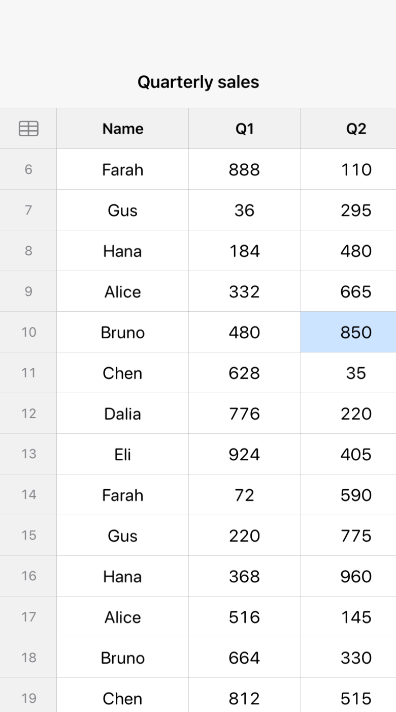

# DataGrid

A SwiftUI grid with a **pinned header row and pinned first column** that stays smooth at **100,000+ rows**.

<p align="center"></p>

SwiftUI has no lazy table that pins in both directions. `LazyVGrid` only pins section headers, `Grid`
builds every cell up front, and `Table` collapses to one column on iPhone. The usual workaround is two
scroll views kept in sync by hand, which drifts. DataGrid is one scroll view:

- **Lazy.** Only the cells in and just around the viewport exist. A 100,000-row grid builds a screenful of
  cells, not 100,000 rows' worth.
- **Pinned, with no lag.** The header row, the first column and the corner are repositioned with
  `visualEffect` inside the scroll content, in the same render pass as the scroll, instead of following it
  with state a frame late.
- **Index-based.** You say how many rows and columns there are and draw a cell for `(row, column)`. There is
  no array to build, so it suits spreadsheets, schedules, logs and comparison tables.
- **Resizable columns, tap selection, VoiceOver hints.**

Requires iOS 18, macOS 15 or visionOS 2 (it uses `onScrollGeometryChange`).

## Use it

```swift
import DataGrid

struct SalesView: View {
    @State private var widths: [CGFloat] = [130, 110, 110, 110]
    @State private var selection: GridPosition?

    var body: some View {
        DataGrid(rows: 100_000, columnWidths: $widths, selection: $selection) { row, column in
            Text(value(row, column))                     // any view
        } columnHeader: { column in
            Text(titles[column]).bold()
        } rowHeader: { row in
            Text("\(row + 1)").foregroundStyle(.secondary)
        } corner: {
            Image(systemName: "tablecells")
        }
    }
}
```

Fixed columns and no pinned first column is shorter:

```swift
DataGrid(rows: 5_000, columns: 8, columnWidth: 120) { row, column in
    Text("\(row),\(column)")
} columnHeader: { column in
    Text("Column \(column)")
}
```

Add the package in Xcode (**File → Add Package Dependencies**) with
`https://github.com/christopher-inegbedion/DataGrid`, or in `Package.swift`:

```swift
.package(url: "https://github.com/christopher-inegbedion/DataGrid", from: "0.1.0")
```

### Options

| | |
|---|---|
| `rows` | Number of body rows |
| `columnWidths` | A `Binding<[CGFloat]>`, one width per column. Dragging a header's trailing edge changes it |
| `rowHeight`, `headerHeight` | Fixed heights (default 40) |
| `rowHeaderWidth` | Width of the pinned first column; `0` for none (default 56) |
| `minimumColumnWidth` | Narrowest a column can be dragged to (default 48) |
| `selection` | `Binding<GridPosition?>`; tapping a cell selects it |

## How it works

`GridGeometry` holds the layout maths and has no SwiftUI in it. Rows share one height, so a row's position is a
multiplication and the visible rows are a division. Columns have their own widths, so their positions are a
running total and the visible columns are found by binary search. `onScrollGeometryChange` maps the scroll
position to the set of visible rows and columns, and only fires when that set changes, so the view updates a
few times a second while scrolling, not once per frame.

## Tested

- Layout maths: 11 unit tests (`swift test`), including boundaries, overscroll, empty grids and zero-width columns.
- The real view, on an iOS simulator, scrolled to the top, to about row 3,000 and to the bottom of a 100,000-row
  grid: the header, row header and corner are checked by pixel colour to stay put while the body scrolls; only
  a screenful of cells is built; and the last row and column are reachable.

Not covered by automated tests: column resizing by drag, tap selection, VoiceOver behaviour, and macOS and
visionOS appearance (they build, but are not exercised).

## Limits

- Every row has the same height.
- No sorting, editing, multi-selection or drag-and-drop.
- Only rows near the viewport exist, so VoiceOver reads those rather than the whole table.
- The grid is read-only data display; it does not own your data.

## Contributing

Issues and pull requests welcome. Run `swift test` and the simulator tests before sending one.

MIT licensed.
